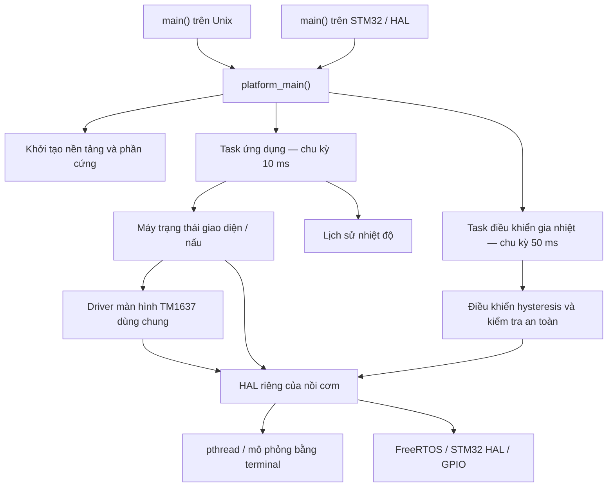

# Tổng quan kiến trúc dự án Rice Cooker

Tôi đã đọc toàn bộ 47 tệp được Git theo dõi trong repository. Đây là một ứng dụng nhúng viết bằng C23, có phần lõi dùng chung và hai backend nền tảng có thể thay thế cho nhau: trình mô phỏng trên Unix terminal và firmware dành cho STM32F103C8. Các tệp sinh ra khi build và mã nguồn thư viện bên thứ ba được tải về không thuộc phạm vi phân tích.

## Các tầng kiến trúc

| Tầng | Trách nhiệm |
|---|---|
| `src/main` | Khởi tạo ứng dụng, máy trạng thái giao diện, quy trình nấu, đếm ngược, lựa chọn nội dung hiển thị và thống kê nhiệt độ |
| `src/drivers` | Bộ điều khiển gia nhiệt và giao thức màn hình TM1637 độc lập với nền tảng |
| `src/include` | Các interface cho phần cứng, luồng thực thi, cấp phát bộ nhớ và khởi động nền tảng |
| `impl/unix` | Bản triển khai desktop dùng pthread, nhập liệu terminal và mô phỏng màn hình LED bảy đoạn bằng ANSI |
| `impl/stm32c8` | Khởi động STM32, timer, adapter FreeRTOS, cấp phát bộ nhớ và truy cập phần cứng cấp thấp |
| `builder` / `cmake` | Chọn backend, tải dependency nhúng, cross-compile và đóng gói firmware |

## Lõi ứng dụng dùng chung

Điểm điều phối chính là [`platform_main()`](C:/Users/SONPHUONG/Desktop/Projects/rice-cooker-notabomb/src/main/appstart.c:16). Hàm này khởi tạo các primitive của nền tảng, khởi tạo lớp trừu tượng phần cứng của nồi cơm, chuẩn hóa màn hình, khởi tạo trạng thái ứng dụng, tạo hai task và khởi động scheduler.

Ứng dụng có hai vòng lặp chạy đồng thời:

- [`task_main_app_thread()`](C:/Users/SONPHUONG/Desktop/Projects/rice-cooker-notabomb/src/main/ricecooker.c:408) chạy mỗi 10 ms. Nó phát hiện cạnh nhấn nút, cập nhật timer và trạng thái nấu, kiểm tra lỗi rồi vẽ lại màn hình.
- [`task_heater_update_thread()`](C:/Users/SONPHUONG/Desktop/Projects/rice-cooker-notabomb/src/drivers/heaterctl.c:48) chạy mỗi 50 ms. Nó điều khiển bộ gia nhiệt độc lập và thực thi các giới hạn an toàn.

Toàn bộ trạng thái ứng dụng nằm trong các biến `static` cấp tệp. Không có mô hình object hoặc hàng đợi sự kiện; thiết kế hiện tại là một máy trạng thái hữu hạn được thăm dò định kỳ.

Máy trạng thái giao diện hỗ trợ các trạng thái chờ, lỗi, chọn chế độ, đang nấu, giữ ấm, chờ hẹn giờ, cấu hình nhiệt độ thủ công và cấu hình thời gian. Mọi chuyển trạng thái do nút bấm được tập trung trong [`app_on_btns_press()`](C:/Users/SONPHUONG/Desktop/Projects/rice-cooker-notabomb/src/main/ricecooker.c:129), còn [`update_rc_display()`](C:/Users/SONPHUONG/Desktop/Projects/rice-cooker-notabomb/src/main/ricecooker.c:244) chịu trách nhiệm hiển thị từng trạng thái.

Các chế độ được khai báo gồm nấu cơm thường, nấu nhanh, nấu cháo, ninh/hầm, làm flan, giữ ấm, điều khiển thủ công và hẹn giờ.

## Điều khiển gia nhiệt và an toàn

Bộ điều khiển gia nhiệt được tách khỏi máy trạng thái giao diện. Ứng dụng chỉ đặt cờ bật/tắt và nhiệt độ mục tiêu của nồi; task gia nhiệt đọc hai cảm biến nhiệt độ rồi trực tiếp điều khiển relay phần cứng.

Chính sách điều khiển hiện tại gồm:

- Vùng hysteresis ±4 °C quanh nhiệt độ mục tiêu để tránh đóng/ngắt relay liên tục.
- Ngưỡng an toàn 220 °C cho phần tử gia nhiệt.
- Báo lỗi thiếu nhiệt nếu cả hai cảm biến không tăng đủ trong 5,6 giây.
- Bảo vệ trạng thái dùng chung thông qua interface critical section độc lập với nền tảng.

Các lỗi được chuyển về watchdog của ứng dụng. Watchdog tắt quá trình nấu và hiển thị mã lỗi 14, 15 hoặc 19. Các mẫu nhiệt độ cũng được lưu trong ring buffer 16 phần tử; [`tempstats.c`](C:/Users/SONPHUONG/Desktop/Projects/rice-cooker-notabomb/src/main/tempstats.c:4) có hàm tính trung bình và độ dốc hồi quy tuyến tính.

## Ngăn xếp hiển thị

[`tm1637dv.c`](C:/Users/SONPHUONG/Desktop/Projects/rice-cooker-notabomb/src/drivers/tm1637dv.c:17) là driver TM1637 dùng chung. Driver này:

- Chuyển chữ số và một tập chữ cái giới hạn thành bitmask LED bảy đoạn.
- Điều khiển độ sáng và trạng thái bật/tắt màn hình.
- Hiển thị dấu hai chấm qua bit dấu chấm thập phân của chữ số thứ hai.
- Cache bốn bitmask gần nhất để tránh ghi lặp lại lên bus.
- Chỉ giao các thao tác điện cấp thấp `start`, `write` và `stop` cho HAL của nền tảng.

Nhờ đó, ứng dụng dùng chính xác cùng một mã định dạng và hoạt ảnh hiển thị trên cả trình mô phỏng lẫn phần cứng thật.

## Ranh giới nền tảng

Port phần cứng chính là [`rchal.h`](C:/Users/SONPHUONG/Desktop/Projects/rice-cooker-notabomb/src/include/rchal.h:7). Nó trừu tượng hóa:

- Nút bấm.
- Cảm biến nhiệt độ nồi và phần tử gia nhiệt.
- Công tắc bộ gia nhiệt.
- Còi báo.
- Đồng hồ mili giây.
- Giao tiếp TM1637 cấp thấp.

[`xthreads.h`](C:/Users/SONPHUONG/Desktop/Projects/rice-cooker-notabomb/src/include/xthreads.h:8) tương tự, trừu tượng hóa việc tạo task, sleep, dừng task và critical section. Dự án còn có một lớp cấp phát bộ nhớ nhỏ, nhưng lõi dùng chung hiện chưa sử dụng nó.

Vì vậy, dự án có cấu trúc ports-and-adapters: lõi chỉ phụ thuộc vào các interface C ổn định, còn từng target cung cấp bản triển khai cụ thể.

## Bản triển khai Unix

Target Unix tạo pthread ngay khi được yêu cầu, dùng một mutex toàn cục cho critical section, đọc các phím `Q/W/E/R/T` từ terminal ở chế độ noncanonical và mô phỏng lệnh cùng RAM hiển thị của TM1637. Màn hình được vẽ thành bốn chữ số LED bảy đoạn bằng mã màu ANSI.

Cảm biến Unix hiện luôn trả về 25 °C, còi báo chưa làm gì và bộ gia nhiệt chỉ là một biến Boolean. Do đó, khi thực sự bắt đầu nấu, trình mô phỏng sẽ phát sinh lỗi thiếu nhiệt thay vì mô phỏng diễn biến nhiệt thực tế.

## Bản triển khai STM32

Target STM32 sử dụng:

- STM32 HAL và CMSIS.
- FreeRTOS 11.1 với hai task cùng mức ưu tiên, được cấp phát động.
- Heap FreeRTOS 8 KB.
- TIM4 làm tick mili giây cho HAL.
- TIM2 tạo delay chặn theo micro giây.
- GPIO B10/B11 để bit-bang bus TM1637.
- Dao động nội 8 MHz, không dùng PLL.

Backend phần cứng vẫn chưa hoàn thiện: nút bấm luôn trả về trạng thái không nhấn, cảm biến luôn trả về 25 °C, còi không làm gì và công tắc bộ gia nhiệt chỉ cập nhật một biến Boolean giả trong [`rchal.c`](C:/Users/SONPHUONG/Desktop/Projects/rice-cooker-notabomb/impl/stm32c8/rchal.c:62). Hiện chỉ phần thời gian, tích hợp FreeRTOS và bus màn hình có bản triển khai phần cứng đáng kể.

## Kiến trúc build

[`CMakeLists.txt`](C:/Users/SONPHUONG/Desktop/Projects/rice-cooker-notabomb/CMakeLists.txt:5) ở thư mục gốc chọn target thông qua tùy chọn `RICECOOKER_BUILD_STM32`.

Toàn bộ tệp dưới `src` được build thành thư viện tĩnh C23 tên `ricecooker_core`. Chương trình Unix liên kết thư viện này với pthread. Firmware STM32 liên kết nó với STM32 HAL, CMSIS và FreeRTOS, sau đó tạo các tệp ELF, BIN, HEX, MAP cùng báo cáo kích thước.

Bốn preset cung cấp cấu hình debug/release cho host và STM32. Các dependency nhúng được tải ở những tag cố định. Linker script mô tả 64 KB flash và 20 KB RAM của STM32F103C8.

## Mức độ hoàn thiện hiện tại

Kiến trúc là một bộ khung firmware đa nền tảng hợp lý, nhưng logic sản phẩm vẫn ở mức prototype:

- [`begin_task_cooking()`](C:/Users/SONPHUONG/Desktop/Projects/rice-cooker-notabomb/src/main/ricecooker.c:473) luôn đặt mục tiêu 100 °C, không phụ thuộc chế độ hoặc nhiệt độ thủ công.
- Logic nấu định kỳ và xử lý hoàn tất quá trình nấu còn trống.
- Trạng thái và nội dung hiển thị giữ ấm đã tồn tại, nhưng chưa có đường chuyển trạng thái đi vào đó.
- Thống kê nhiệt độ được thu thập nhưng chưa tham gia quyết định điều khiển.
- Quá trình khởi tạo hiện đặt thẳng trạng thái thành `STATE_COOKING` mà không gọi hàm bắt đầu nấu, khiến giao diện trông như đang nấu trong khi bộ gia nhiệt vẫn tắt.
- Phần lớn I/O vật lý trên STM32 vẫn là stub.
- Chưa có kiểm thử tự động, tài liệu sử dụng, lưu trữ bền vững hoặc hệ thống chẩn đoán/logging.

Nhìn tổng thể, đây là một prototype nhúng hai task có khả năng chạy trên nhiều nền tảng. Dự án đã tách biệt tốt phần mô phỏng và phần cứng, đồng thời đã có nền tảng cho giao diện, màn hình, thời gian và an toàn gia nhiệt; tuy nhiên logic nấu và I/O phần cứng vẫn cần được hoàn thiện trước khi có thể xem là firmware sẵn sàng triển khai.
